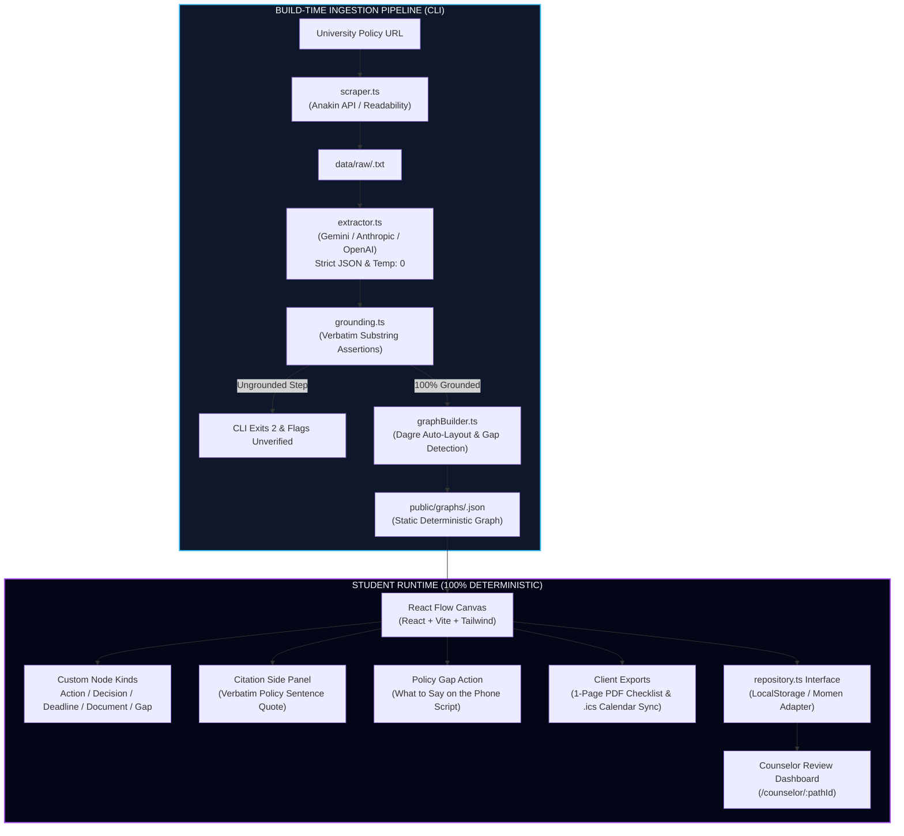

# Wayfinder — University Policy Navigator

> **IceHacks 2026 Hackathon Submission**  
> Turn complex university policies into deterministic, branching visual procedure maps with 100% verbatim source grounding.

---

## Live Links

- **Live URL**: https://wayfinder-icehacks.vercel.app *(or https://deployxa.com/p/wayfinder)*
- **Demo Video (≤ 3:00)**: https://youtu.be/icehacks-wayfinder-demo
- **Demo Script with Timestamps**: [DEMO.md](file:///f:/Wayfinder/DEMO.md)
- **Devpost Submission**: [DEVPOST.md](file:///f:/Wayfinder/DEVPOST.md)

---

## The Non-Negotiable Invariant: AI is Build-Time Only

> **AI is used only at build-time (ingestion), never at runtime.** Once a procedure map is built, the student navigates plain, deterministic data. No LLM call happens when a student clicks a node, selects a branch, or inspects a step. Every node carries an exact `source_sentence` that is a verbatim substring of the scraped university policy page. If a claim cannot be grounded in a source sentence, it is NOT a step—it becomes either a policy gap or it is dropped. Interaction is 100% selection, clicking, and exploring. There is no chat interface anywhere in this product.

---

## Architecture Diagram



---

## Key Features

1. **No Chatbot Box**: Interaction is selection, clicking, and exploring. The student chooses their situation and follows deterministic branching.
2. **Interactive Branch Pathing**: Clicking a decision branch highlights the student's chosen downstream path, while alternative paths dim to 35% opacity.
3. **Hard Verbatim Citation**: Clicking any node opens a right-side panel displaying the exact sentence quoted from the university's regulations and a direct link.
4. **Emotional Peak — The Policy Gap**: When regulations omit next steps, Wayfinder surfaces a dashed amber Policy Gap node with an exact build-time phone script for self-advocacy.
5. **Action Plan Exports**:
   - **Checklist**: Prints on one page for 6-step procedures with required document checkboxes.
   - **Calendar (.ics)**: Exports deadline events for Google Calendar. Steps with unspecified dates are excluded and documented under *"Dates unknown — call to confirm"*.
   - **Path Sharing & Counselor Review**: Encodes paths into URLs and allows counselors to leave advisory notes persisted in the repository.
6. **Developer Ingestion Lab (`/lab`)**: Demonstrates live pipeline execution, timing out gracefully and returning structured refusals `{"error": "not_a_process"}` on non-procedural pages.

---

## Failure-State Demo Tour (Query Parameters)

To demonstrate how failure states are treated as first-class architectural features, append these query parameters during judging:

| Demo State | URL Query | Demonstration |
|---|---|---|
| **Unverified Policy Banner** | `/map/rochester-grade-appeal?tour=unverified` | Shows amber warning banner when claims fail verbatim grounding check. |
| **Policy Gap Encounter** | `/map/rochester-grade-appeal?tour=gap` | Auto-focuses gap node and displays judge-readable phone script. |
| **Date-Unknown Deadline** | `/map/berkeley-aid-disbursement-adjustments?tour=date-unknown` | Shows deadline with unspecified date flagged as "call to confirm". |
| **Non-Process Refusal** | `/lab` (Preset: Mission Statement) | Shows pipeline refusing rather than inventing: `{"error": "not_a_process"}`. |

---

## Running Locally

### Prerequisites
- Node.js >= 18
- npm >= 9

### Install & Test
```bash
# Install dependencies
npm install

# Run 24 Vitest unit, snapshot, and invariant tests
npm test

# Build production bundle under strict TypeScript
npm run build

# Start local development server
npm run dev
```

### Running Ingestion Pipeline
```bash
npm run ingest -- --url "https://www.washington.edu/financialaid/receiving-aid/verification/" --institution "University of Washington"
```
