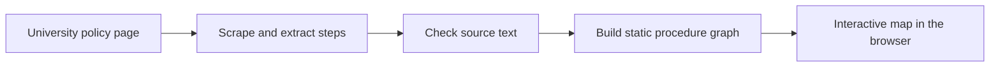

# Wayfinder

**Turn university policies into interactive, source-linked procedure maps.**

Wayfinder helps students make sense of administrative procedures such as grade appeals and financial aid verification. Choose a situation, follow the relevant branches, and open a step to see the policy text it came from. The student experience is a visual map rather than a chatbot.

> Wayfinder is a navigation aid, not an official university service. Policies can change; confirm current requirements and deadlines with the university before acting.

## Try Wayfinder

- [Open the live app](https://wayfinder-icehacks.vercel.app)
- [Watch the demo video](https://youtu.be/icehacks-wayfinder-demo)

## What you can do

- Explore procedures as interactive maps and choose branches that match your situation.
- Inspect a step's source sentence and open the original university policy page.
- See where a policy leaves a question unanswered, with a suggested question to ask the university.
- Export a printable checklist or an `.ics` calendar file for dated deadlines.
- Save a path in your browser or share it by URL for review.

Wayfinder uses an LLM during procedure ingestion to extract candidate steps. A deterministic validator checks those steps against the scraped policy text; an ungrounded step causes the procedure to be marked unverified. Once a map is built, exploring it uses static graph data and does not make LLM calls.

## Sample policy maps

| Institution | Procedure | Official source |
|---|---|---|
| UC Berkeley | Financial aid and enrollment adjustments | [Financial Aid: How Aid Works](https://financialaid.berkeley.edu/how-aid-works/) |
| University of Rochester | Academic grade appeals | [College Center for Advising Services: Grade Appeal](https://www.rochester.edu/college/ccas/handbook/grade-appeal.html) |
| University of Washington | IRS verification of non-filing | [Financial Aid: Verification](https://www.washington.edu/financialaid/receiving-aid/verification/) |

Each map includes its source URL and retrieval timestamp. Check the linked university page for the current policy.

## How it works



The graph builder creates decision, action, deadline, document, contact, and policy-gap nodes. Layout and navigation are deterministic. If the source does not specify a next step, the map can surface that gap instead of presenting a guess as policy.

## Run locally

### Requirements

- Node.js 18 or newer
- npm 9 or newer

### Start the app

The sample maps are included in `public/graphs`, so no API credentials are needed to explore them.

```bash
npm install
npm run dev
```

Open the local URL printed by Vite. To create a production build or run the existing test suite:

```bash
npm run build
npm test
```

## Ingest a policy (optional)

Ingestion fetches a policy page, extracts candidate procedure steps with an LLM, validates their source sentences, and writes a procedure JSON file to `data/procedures/`. It requires an LLM API key. The Anakin scraping API key is optional; without it, the pipeline falls back to Readability.

Copy `.env.example` to `.env` and set `LLM_API_KEY` for the provider selected by `LLM_PROVIDER` (Gemini is the default). You can also set provider-specific keys such as `OPENAI_API_KEY` or `ANTHROPIC_API_KEY`. Set `ANAKIN_API_KEY` only if you want to use that scraper.

```bash
npm run ingest -- --url "https://www.washington.edu/financialaid/receiving-aid/verification/" --institution "University of Washington"
```

To build static graphs from the JSON files in `data/procedures/`:

```bash
npx tsx scripts/buildGraphs.ts
```

This writes graph JSON files and a manifest to `public/graphs/`. Review generated content and its citations before publishing a map. The grounding check confirms that cited sentences appear in the retrieved text; it does not guarantee that a policy interpretation is complete or current.

## Tech stack

React, TypeScript, Vite, Tailwind CSS, React Flow (`@xyflow/react`), Dagre, and Zod.

## Data and saved paths

Procedure maps are static JSON files served by the app. Saved paths and counselor notes use browser `localStorage` in the default configuration; they are not synced to a shared account or server. The repository interface includes a REST adapter, but the local-storage adapter is enabled by default.
